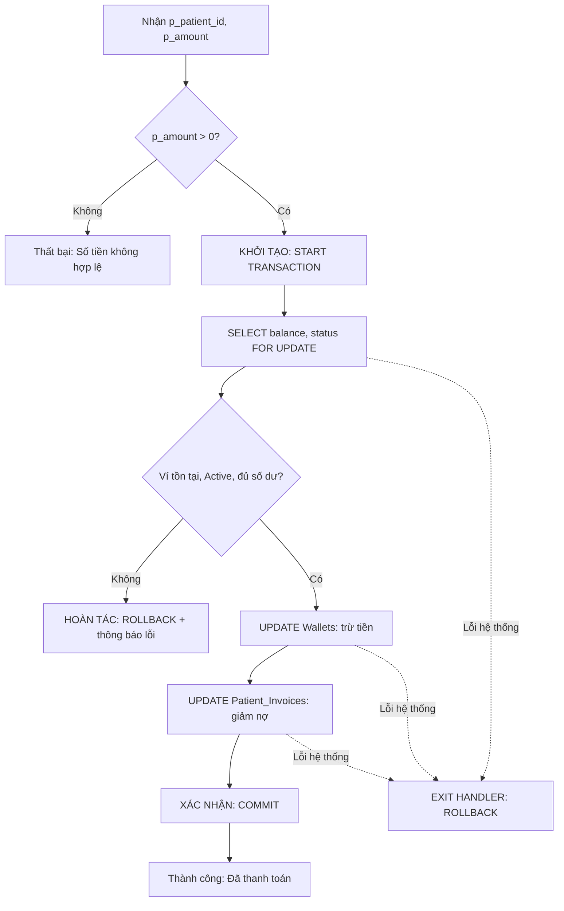

# Chiến lược kiểm soát giao dịch thanh toán

Phân tích và so sánh 2 chiến lược kiểm soát giao dịch cho tính năng "Thanh toán một chạm", chọn giải pháp tối ưu và triển khai thủ tục `ProcessPayment`.

## 1. Đề bài

- **Bối cảnh:** khi bệnh nhân thanh toán viện phí bằng Ví điện tử, hệ thống phải thực hiện đồng thời 2 thao tác: trừ tiền trong ví và giảm trừ khoản nợ tương ứng. Quá trình phải tuyệt đối an toàn, không thất thoát tiền trong mọi tình huống.
- **Đầu vào:** thông tin giao dịch (mã bệnh nhân, số tiền thanh toán).
- **Đầu ra:** thực thi cập nhật dữ liệu và trả về một "Thông báo trạng thái" hiển thị trên màn hình.
- **Ràng buộc:** không được thanh toán nếu số dư ví nhỏ hơn số tiền thanh toán.
- **Vấn đề hiện tại:**
  - **Tình huống 1:** lỗi hệ thống giữa chừng; tiền trong ví đã trừ nhưng nợ chưa giảm, bệnh nhân mất tiền oan.
  - **Tình huống 2:** số dư không đủ nhưng hệ thống không kiểm tra, vẫn cập nhật làm ví bị âm tiền.

Bảng và dữ liệu mẫu (trong `chien_luoc_thanh_toan.sql`):

```sql
CREATE TABLE Wallets (
    wallet_id  INT PRIMARY KEY,
    patient_id INT            NOT NULL UNIQUE,
    balance    DECIMAL(15, 2) NOT NULL DEFAULT 0,
    status     VARCHAR(20)    NOT NULL DEFAULT 'Active',
    CONSTRAINT chk_wallet_balance CHECK (balance >= 0)
) ENGINE = InnoDB;

CREATE TABLE Patient_Invoices (
    patient_id INT PRIMARY KEY,
    total_due  DECIMAL(15, 2) NOT NULL DEFAULT 0
) ENGINE = InnoDB;

INSERT INTO Wallets (wallet_id, patient_id, balance) VALUES
    (1, 1, 1000000),
    (2, 2,  100000);

INSERT INTO Patient_Invoices (patient_id, total_due) VALUES
    (1, 600000),
    (2, 300000);
```

## 2. Phần A – Phân tích và đề xuất giải pháp

### Định nghĩa I/O

Thủ tục dùng **3 tham số**:

| Tham số | Loại | Kiểu | Ý nghĩa |
|---|---|---|---|
| `p_patient_id` | `IN` | INT | Mã bệnh nhân |
| `p_amount` | `IN` | DECIMAL(15,2) | Số tiền thanh toán |
| `p_message` | `OUT` | VARCHAR(255) | Thông báo trạng thái trả về màn hình |

Hai thông tin giao dịch chỉ cần truyền vào nên dùng `IN`; thông báo trạng thái do thủ tục tạo ra để trả về nên dùng `OUT`. Không cần `INOUT` vì không có giá trị nào vừa truyền vào vừa bị sửa rồi trả lại.

### Chiến lược 1: Chạy thẳng lệnh cập nhật, dựa vào Exception mặc định của Database

Mở giao dịch, chạy luôn 2 lệnh `UPDATE`. Nếu có lỗi (sập kết nối, hoặc ràng buộc `CHECK (balance >= 0)` bị vi phạm khi ví âm), `EXIT HANDLER` bắt lỗi và `ROLLBACK`.

```sql
CREATE PROCEDURE ProcessPayment_Strategy1(IN p_patient_id INT, IN p_amount DECIMAL(15, 2), OUT p_message VARCHAR(255))
BEGIN
    DECLARE EXIT HANDLER FOR SQLEXCEPTION
    BEGIN
        ROLLBACK;
        SET p_message = 'Thất bại: Giao dịch bị lỗi và đã được hoàn tác';
    END;

    START TRANSACTION;
    UPDATE Wallets          SET balance   = balance   - p_amount WHERE patient_id = p_patient_id;
    UPDATE Patient_Invoices SET total_due = total_due - p_amount WHERE patient_id = p_patient_id;
    COMMIT;
    SET p_message = 'Thành công';
END
```

### Chiến lược 2: Truy xuất và đối chiếu dữ liệu trước

Mở giao dịch, đọc số dư bằng `SELECT ... FOR UPDATE`, chủ động kiểm tra từng quy tắc. Vi phạm thì `ROLLBACK` ngay và trả thông báo cụ thể; chỉ khi dữ liệu hợp lệ hoàn toàn mới chạy 2 lệnh cập nhật rồi `COMMIT`.

### So sánh và lựa chọn

| Tiêu chí | Chiến lược 1: Exception mặc định | Chiến lược 2: Đối chiếu trước |
|---|---|---|
| Xử lý Tình huống 1 (lỗi giữa chừng) | Có, nhờ `ROLLBACK` trong handler | Có, nếu kèm handler |
| Xử lý Tình huống 2 (không đủ số dư) | Chỉ khi bảng có `CHECK (balance >= 0)`; không có ràng buộc này thì ví vẫn bị âm | Có, kiểm tra trực tiếp `balance < amount` |
| Số tiền âm (VD −50.000) | **Không chặn được**: ví được cộng thêm tiền, nợ tăng lên, không có lỗi nào xảy ra | Chặn được bằng kiểm tra `p_amount <= 0` |
| Bệnh nhân không có ví | `UPDATE` sửa 0 dòng, không lỗi, vẫn báo "Thành công" | Phát hiện được (`v_balance IS NULL`) |
| Thông báo cho người dùng | Chung chung, không biết lý do thất bại | Cụ thể từng lý do |
| Hiệu năng | Ghi dữ liệu rồi mới hoàn tác khi lỗi, tốn tài nguyên | Dừng sớm trước khi ghi |
| Độ dài mã | Ngắn, đơn giản | Dài hơn, phải liệt kê đủ các quy tắc |
| Lỗi bất ngờ không lường trước | Bắt được tất cả | Không bắt được nếu không có handler |

**Quyết định:** chọn **Chiến lược 2, kết hợp `EXIT HANDLER` của Chiến lược 1 làm lưới an toàn**. Chiến lược 2 xử lý được mọi quy tắc nghiệp vụ, trả thông báo rõ ràng và chặn được cả các lỗi mà Database không coi là lỗi (số tiền âm, không có ví). Handler bổ sung bảo đảm các sự cố hệ thống không lường trước vẫn được hoàn tác. Ràng buộc `CHECK (balance >= 0)` vẫn được giữ trên bảng như chốt chặn cuối cùng.

## 3. Phần B – Thiết kế và triển khai

### Luồng xử lý

1. Kiểm tra `p_amount`: nếu `NULL` hoặc ≤ 0, trả `"Thất bại: Số tiền thanh toán không hợp lệ"` và thoát (chưa mở giao dịch).
2. **[KHỞI TẠO]** `START TRANSACTION`.
3. `SELECT balance, status ... FOR UPDATE` để đọc và khóa dòng ví.
4. Không tìm thấy ví, ví bị khóa, hoặc `balance < p_amount`: **[HOÀN TÁC]** `ROLLBACK`, trả thông báo tương ứng, thoát.
5. `UPDATE Wallets` (trừ tiền), rồi `UPDATE Patient_Invoices` (giảm nợ).
6. **[XÁC NHẬN]** `COMMIT`, trả thông báo thành công.
7. Lỗi bất ngờ ở bước 3 đến 6: `EXIT HANDLER` thực hiện **[HOÀN TÁC]** `ROLLBACK` và trả thông báo lỗi hệ thống.



### Mã nguồn

```sql
DROP PROCEDURE IF EXISTS ProcessPayment;

DELIMITER //

CREATE PROCEDURE ProcessPayment(
    IN  p_patient_id INT,
    IN  p_amount     DECIMAL(15, 2),
    OUT p_message    VARCHAR(255)
)
proc: BEGIN
    DECLARE v_balance DECIMAL(15, 2) DEFAULT NULL;
    DECLARE v_status  VARCHAR(20)    DEFAULT NULL;

    -- Lưới an toàn: lỗi bất ngờ (sập kết nối, vi phạm ràng buộc...) -> hoàn tác toàn bộ
    DECLARE EXIT HANDLER FOR SQLEXCEPTION
    BEGIN
        ROLLBACK;                                          -- [HOÀN TÁC]
        SET p_message = 'Thất bại: Lỗi hệ thống, giao dịch đã được hoàn tác';
    END;

    -- Bước 1: kiểm tra đầu vào (chưa đụng tới dữ liệu)
    IF p_amount IS NULL OR p_amount <= 0 THEN
        SET p_message = 'Thất bại: Số tiền thanh toán không hợp lệ';
        LEAVE proc;
    END IF;

    START TRANSACTION;                                     -- [KHỞI TẠO]

    -- Bước 2: truy xuất và khóa dòng ví
    SELECT balance, status INTO v_balance, v_status
    FROM Wallets
    WHERE patient_id = p_patient_id
    FOR UPDATE;

    -- Bước 3: đối chiếu dữ liệu, vi phạm quy tắc thì chủ động hoàn tác
    IF v_balance IS NULL THEN
        ROLLBACK;                                          -- [HOÀN TÁC]
        SET p_message = 'Thất bại: Không tìm thấy ví của bệnh nhân';
        LEAVE proc;
    END IF;

    IF v_status <> 'Active' THEN
        ROLLBACK;                                          -- [HOÀN TÁC]
        SET p_message = 'Thất bại: Ví đang bị khóa';
        LEAVE proc;
    END IF;

    IF v_balance < p_amount THEN
        ROLLBACK;                                          -- [HOÀN TÁC]
        SET p_message = 'Thất bại: Số dư ví không đủ';
        LEAVE proc;
    END IF;

    -- Bước 4: thực thi 2 thao tác đồng thời
    UPDATE Wallets
    SET balance = balance - p_amount
    WHERE patient_id = p_patient_id;

    UPDATE Patient_Invoices
    SET total_due = total_due - p_amount
    WHERE patient_id = p_patient_id;

    -- Bước 5: xác nhận
    COMMIT;                                                -- [XÁC NHẬN]
    SET p_message = CONCAT('Thành công: Đã thanh toán ', FORMAT(p_amount, 0), ' đồng');
END //

DELIMITER ;
```

## 4. Kiểm thử

```sql
CALL ProcessPayment(1, 400000, @msg);  SELECT @msg AS message;  -- (1) hợp lệ
CALL ProcessPayment(2, 300000, @msg);  SELECT @msg AS message;  -- (2) không đủ số dư
CALL ProcessPayment(1, -50000, @msg);  SELECT @msg AS message;  -- (3) số tiền âm
```

| Trường hợp | Dữ liệu | @msg |
|---|---|---|
| 1. Hợp lệ | BN 1, ví 1.000.000, trả 400.000 | `Thành công: Đã thanh toán 400,000 đồng` |
| 2. Không đủ số dư | BN 2, ví 100.000, trả 300.000 | `Thất bại: Số dư ví không đủ` |
| 3. Số tiền âm | BN 1, trả −50.000 | `Thất bại: Số tiền thanh toán không hợp lệ` |

Dữ liệu sau 3 lần gọi (chỉ trường hợp 1 làm thay đổi dữ liệu):

| patient_id | balance | total_due |
|---|---|---|
| 1 | 600000.00 | 200000.00 |
| 2 | 100000.00 | 300000.00 |
