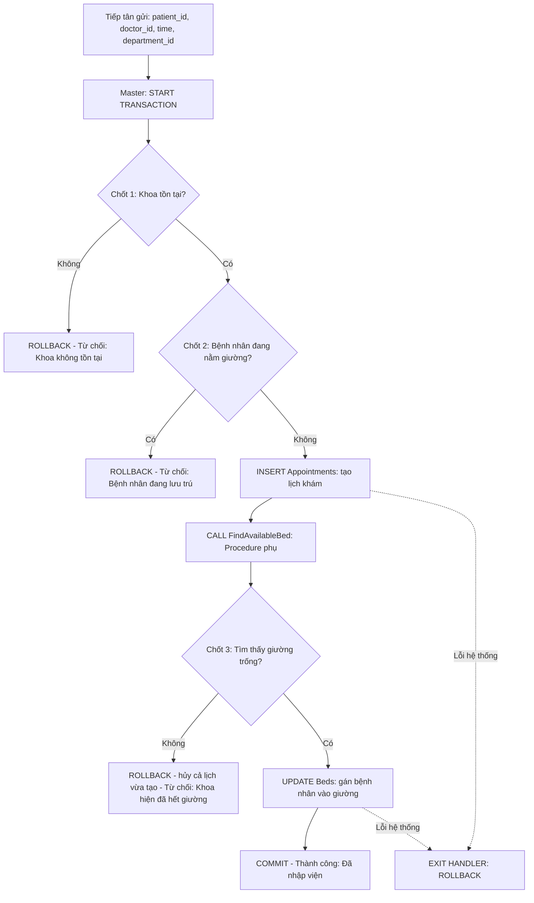

# Tự động hóa nhập viện khẩn cấp

Thiết kế kiến trúc Procedure Master và Procedure phụ để tạo lịch khám và xếp giường bệnh trong một khối giao dịch thống nhất, tránh lỗi "lịch khám đã tạo nhưng bệnh nhân không có giường".

## 1. Đề bài

- **Quy trình hiện tại:** gồm 2 bước thủ công: (1) tạo Lịch khám mới, (2) gán Giường bệnh trống. Do làm thủ công và mạng chập chờn, thường xảy ra lỗi lịch khám đã tạo nhưng bệnh nhân không có giường.
- **Yêu cầu:** tiếp tân chỉ cần đẩy Mã bệnh nhân, Mã bác sĩ, Thời gian và Mã khoa vào hệ thống; Database tự xử lý giao dịch và trả về kết quả.
- **Ràng buộc kỹ thuật:**
  - **Kiến trúc module và giao dịch:** tạo lịch và xếp giường phải là một khối thống nhất. Một Procedure Master điều phối, gọi đến một Procedure phụ làm nhiệm vụ "Dò tìm giường trống"; không viết gộp logic.
  - **Hết giường:** khoa không còn giường trống thì hủy giao dịch, không tạo lịch khám, báo lỗi `"Từ chối: Khoa hiện đã hết giường"`.
  - **Đang nội trú:** bệnh nhân đã có giường ở khoa khác thì chặn giao dịch, báo lỗi `"Từ chối: Bệnh nhân đang lưu trú"`.

Bảng và dữ liệu mẫu (trong `nhap_vien_khan_cap.sql`):

```sql
CREATE TABLE Departments (
    department_id   INT PRIMARY KEY,
    department_name VARCHAR(100) NOT NULL
) ENGINE = InnoDB;

CREATE TABLE Beds (
    bed_id        INT PRIMARY KEY,
    department_id INT NOT NULL,
    patient_id    INT NULL UNIQUE,        -- NULL = giường trống
    CONSTRAINT fk_bed_department FOREIGN KEY (department_id) REFERENCES Departments (department_id)
) ENGINE = InnoDB;

CREATE TABLE Appointments (
    appointment_id   INT AUTO_INCREMENT PRIMARY KEY,
    patient_id       INT         NOT NULL,
    doctor_id        INT         NOT NULL,
    department_id    INT         NOT NULL,
    appointment_time DATETIME    NOT NULL,
    status           VARCHAR(20) NOT NULL DEFAULT 'Admitted',
    CONSTRAINT fk_appt_department FOREIGN KEY (department_id) REFERENCES Departments (department_id)
) ENGINE = InnoDB;

INSERT INTO Departments (department_id, department_name) VALUES
    (1, 'Khoa Noi'),
    (2, 'Khoa Cap cuu'),
    (3, 'Khoa Ngoai');

INSERT INTO Beds (bed_id, department_id, patient_id) VALUES
    (101, 1, 10),
    (102, 1, NULL),
    (201, 2, 11),
    (202, 2, 12),
    (301, 3, NULL);
```

Khoa Nội còn 1 giường trống (102), Khoa Cấp cứu đã kín giường, Khoa Ngoại còn giường 301.

## 2. Phần A – Bản vẽ thiết kế kiến trúc

### Flowchart luồng đi của dữ liệu



| Mốc | Vị trí | Vai trò |
|---|---|---|
| `START TRANSACTION` | Đầu Procedure Master | Mở khối giao dịch bao trùm cả 2 Procedure |
| Chốt 1, Chốt 2 | Trước khi ghi dữ liệu | Loại sớm các yêu cầu không hợp lệ |
| Chốt 3 | Sau khi gọi Procedure phụ | Hết giường thì `ROLLBACK`, hủy luôn lịch khám đã `INSERT` ở bước trước |
| `COMMIT` | Cuối Procedure Master | Chỉ lưu khi cả lịch khám và giường đều xong |
| `EXIT HANDLER` | Toàn bộ Procedure Master | Lỗi bất ngờ ở bất kỳ bước nào thì `ROLLBACK` |

Procedure phụ `FindAvailableBed` **không** có `START TRANSACTION` hay `COMMIT`. Nó chạy bên trong giao dịch của Procedure Master, nên dòng giường bị khóa bằng `FOR UPDATE` được giữ khóa tới khi Master `COMMIT` hoặc `ROLLBACK`. Nếu Procedure phụ tự `COMMIT`, nó sẽ lưu luôn lịch khám mà Master vừa tạo, phá vỡ tính nguyên tử.

### Thiết kế giao tiếp giữa Master và Procedure phụ

| Tham số | Loại | Hướng truyền |
|---|---|---|
| `p_department_id` | `IN` | Master truyền mã khoa cho Procedure phụ |
| `p_bed_id` | `OUT` | Procedure phụ trả mã giường trống (hoặc `NULL`) về biến `v_bed_id` của Master |

Master "hứng" kết quả bằng tham số **`OUT`**: Procedure phụ chỉ cần ghi kết quả ra, không cần đọc giá trị ban đầu của biến, nên không dùng `INOUT`. Thông báo trả cho tiếp tân cũng dùng `OUT p_message` của Master.

## 3. Phần B – Triển khai code

```sql
DROP PROCEDURE IF EXISTS FindAvailableBed;

DELIMITER //

CREATE PROCEDURE FindAvailableBed(
    IN  p_department_id INT,
    OUT p_bed_id        INT
)
BEGIN
    -- Không có giường trống thì trả về NULL thay vì phát sinh cảnh báo "No data"
    DECLARE CONTINUE HANDLER FOR NOT FOUND SET p_bed_id = NULL;

    SET p_bed_id = NULL;

    -- Khóa giường được chọn: chạy bên trong giao dịch của Procedure Master
    SELECT bed_id INTO p_bed_id
    FROM Beds
    WHERE department_id = p_department_id
      AND patient_id IS NULL
    ORDER BY bed_id
    LIMIT 1
    FOR UPDATE;
END //

DELIMITER ;

DROP PROCEDURE IF EXISTS AdmitEmergencyPatient;

DELIMITER //

CREATE PROCEDURE AdmitEmergencyPatient(
    IN  p_patient_id       INT,
    IN  p_doctor_id        INT,
    IN  p_appointment_time DATETIME,
    IN  p_department_id    INT,
    OUT p_message          VARCHAR(255)
)
proc: BEGIN
    DECLARE v_bed_id INT DEFAULT NULL;

    -- Lỗi hệ thống bất ngờ: hủy toàn bộ giao dịch
    DECLARE EXIT HANDLER FOR SQLEXCEPTION
    BEGIN
        ROLLBACK;
        SET p_message = 'Thất bại: Lỗi hệ thống, giao dịch đã được hủy';
    END;

    START TRANSACTION;

    -- Chốt kiểm tra 1: khoa phải tồn tại
    IF NOT EXISTS (SELECT 1 FROM Departments WHERE department_id = p_department_id) THEN
        ROLLBACK;
        SET p_message = 'Từ chối: Khoa không tồn tại';
        LEAVE proc;
    END IF;

    -- Chốt kiểm tra 2: bệnh nhân không được đang nằm giường ở bất kỳ khoa nào
    -- (UNIQUE trên Beds.patient_id là chốt chặn cuối nếu 2 yêu cầu chạy song song)
    IF EXISTS (SELECT 1 FROM Beds WHERE patient_id = p_patient_id) THEN
        ROLLBACK;
        SET p_message = 'Từ chối: Bệnh nhân đang lưu trú';
        LEAVE proc;
    END IF;

    -- Bước 1: tạo lịch khám
    INSERT INTO Appointments (patient_id, doctor_id, department_id, appointment_time)
    VALUES (p_patient_id, p_doctor_id, p_department_id, p_appointment_time);

    -- Bước 2: gọi Procedure phụ dò tìm giường trống
    CALL FindAvailableBed(p_department_id, v_bed_id);

    -- Chốt kiểm tra 3: hết giường -> hủy cả lịch khám vừa tạo
    IF v_bed_id IS NULL THEN
        ROLLBACK;
        SET p_message = 'Từ chối: Khoa hiện đã hết giường';
        LEAVE proc;
    END IF;

    -- Bước 3: gán giường cho bệnh nhân
    UPDATE Beds
    SET patient_id = p_patient_id
    WHERE bed_id = v_bed_id;

    COMMIT;
    SET p_message = CONCAT('Thành công: Đã nhập viện, xếp giường ', v_bed_id);
END //

DELIMITER ;
```

- **`DECLARE CONTINUE HANDLER FOR NOT FOUND` trong Procedure phụ:** khi không có giường trống, `SELECT ... INTO` không trả dòng nào; handler gán `p_bed_id = NULL` và cho chạy tiếp để Master xử lý.
- **Thứ tự `INSERT` lịch rồi mới tìm giường:** giúp kiểm chứng tính nguyên tử. Khi hết giường, `ROLLBACK` xóa luôn lịch khám vừa tạo, nên không còn tình trạng "có lịch mà không có giường".
- **Ràng buộc `UNIQUE` trên `Beds.patient_id`:** là chốt chặn cuối. Nếu 2 yêu cầu nhập viện cho cùng một bệnh nhân chạy song song, lệnh gán giường thứ hai vi phạm `UNIQUE` và bị `EXIT HANDLER` hoàn tác.

## 4. Kiểm thử

```sql
CALL AdmitEmergencyPatient(1, 5, '2026-11-19 08:30:00', 1,  @msg); SELECT @msg;  -- (1)
CALL AdmitEmergencyPatient(2, 6, '2026-11-19 09:00:00', 2,  @msg); SELECT @msg;  -- (2)
CALL AdmitEmergencyPatient(1, 7, '2026-11-19 09:30:00', 3,  @msg); SELECT @msg;  -- (3)
CALL AdmitEmergencyPatient(3, 5, '2026-11-19 10:00:00', 99, @msg); SELECT @msg;  -- (4)
```

| Kịch bản | Dữ liệu | @msg |
|---|---|---|
| 1. Nhập viện thành công | BN 1 vào Khoa Nội (còn giường 102) | `Thành công: Đã nhập viện, xếp giường 102` |
| 2. Hết giường | BN 2 vào Khoa Cấp cứu (đã kín) | `Từ chối: Khoa hiện đã hết giường` |
| 3. Đang nội trú | BN 1 (đang ở giường 102) vào Khoa Ngoại | `Từ chối: Bệnh nhân đang lưu trú` |
| 4. Khoa không tồn tại | BN 3 vào khoa 99 | `Từ chối: Khoa không tồn tại` |

Bảng `Appointments` sau 4 lần gọi chỉ có **1 dòng**. Lịch khám của kịch bản 2 đã được `INSERT` nhưng bị `ROLLBACK` cùng giao dịch; vì `AUTO_INCREMENT` không hoàn lại số đã cấp, lịch khám thành công tiếp theo sẽ có `appointment_id` là 3.

| appointment_id | patient_id | doctor_id | department_id | appointment_time | status |
|---|---|---|---|---|---|
| 1 | 1 | 5 | 1 | 2026-11-19 08:30:00 | Admitted |

Bảng `Beds`: chỉ giường 102 thay đổi (`patient_id` từ `NULL` thành 1); giường 301 vẫn trống.
